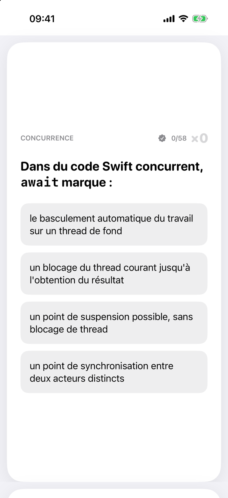
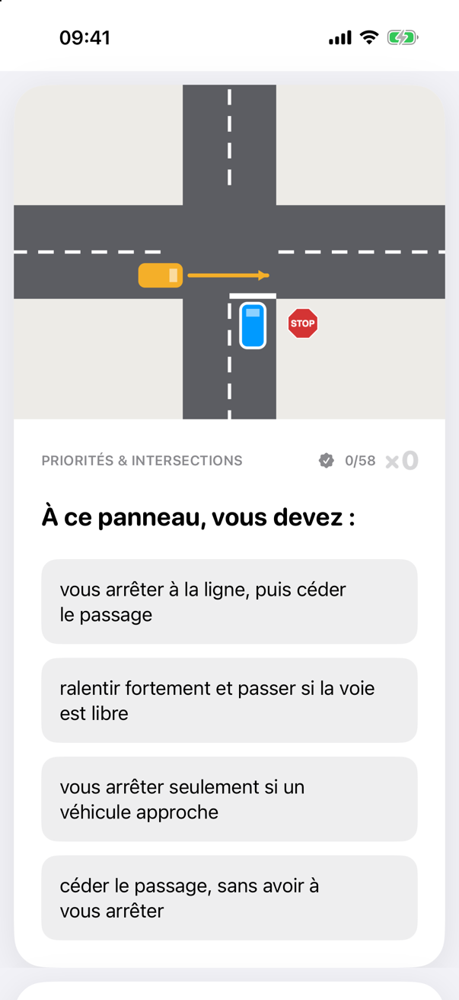
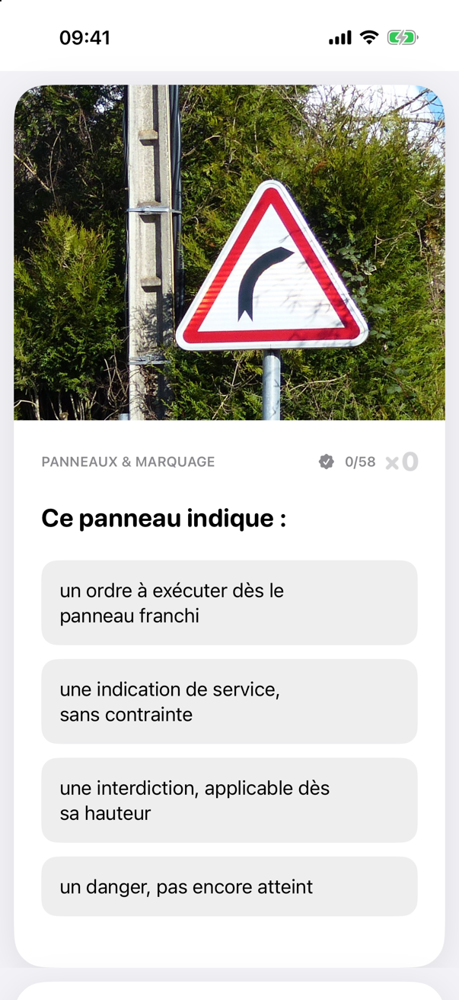

# Valido

Un feed vertical infini qui révise. L'idée est de prendre la place du scroll passif
d'Instagram ou TikTok : même geste, même absence de friction, mais chaque carte est une
question. Deux matières mélangées, le code de la route et Swift/iOS.

Le critère de réussite n'est pas un score d'apprentissage. C'est un réflexe : ouvrir
Valido dans le bus au lieu d'Instagram.

Projet perso, iOS 26.2, SwiftUI, Swift 6.

<p align="center">
  
  
  
</p>

---

## Ce qui tourne

Une seule boucle : un `ScrollView` paginé, une carte plein écran, alimentée à l'approche
du bas. Pas de menu, pas d'écran d'accueil, pas d'écran de fin de session — un « bravo,
terminé ! » est une porte de sortie.

**464 questions** embarquées dans le bundle : 271 sur le code de la route, 193 sur
Swift/iOS. Aucun réseau, aucun compte, aucun secret dans l'app.

**Soixante-seize** de ces questions ont leur énoncé **dans une image** — carrefour, panneau,
marquage, vue conducteur. Sans l'image, « qui passe en premier ? » n'a pas de sens : elle
n'illustre pas, elle énonce.

## Les décisions qui structurent le reste

Elles ne sont pas listées ici : chacune vit en commentaire sur le type qu'elle explique, au
plus près du code qu'elle contraint — `CardScheduler` pour le tirage, `ComboEngine` pour la
mise, `FeedView` et `QuestionCardView` pour la boucle et le bandeau d'image. Les specs de
design sont sous [`docs/superpowers/specs/`](docs/superpowers/specs/).

## Structure

```
Valido/
  Model/       types tous `nonisolated` — QuestionBank, CardScheduler,
               ComboEngine, ProgressStore, SchedulerConfig, Illustration…
  ViewModel/   FeedViewModel, @MainActor
  View/        FeedView, QuestionCardView, ComboBadge, ContentErrorView, NotionBadge,
               SourceFilterView
  Resources/   questions.json
  Assets.xcassets/Scenes/   77 imagesets : 52 schémas dessinés, 25 photos
ValidoTests/   84 tests (Swift Testing)
Tools/         guide de rédaction, rendu des schémas, audit, provenance des images,
               registre de fraîcheur, carte de couverture du référentiel, registre
               des notions
design/logo/   render-icon.swift, le rendu de l'icône
docs/          les specs de design, les captures du README
```

La cible compile avec `SWIFT_DEFAULT_ACTOR_ISOLATION = MainActor`, ce qui isolerait aussi
les types du modèle — or ce sont des types valeur `Sendable` faits pour être utilisables
partout. D'où les `nonisolated` (SE-0466), qui énoncent la couche : **le modèle est sans
isolation, le view model est `@MainActor`, les vues suivent.**

`Valido/` est un dossier synchronisé (`objectVersion = 77`) : tout `.swift` créé sur le
disque est compilé sans toucher au `.pbxproj`.

## Lancer et tester

Xcode avec le SDK iOS 26.2 :

```bash
xcodebuild test -project Valido.xcodeproj -scheme Valido \
  -destination 'platform=iOS Simulator,name=iPhone 17 Pro,OS=26.2'
```

Juger la ligne `✔ Test run with N tests` : Swift Testing rapporte à part, et un
`** TEST SUCCEEDED **` sans elle ne prouve rien.

`CardScheduler` reste la pièce la plus testée, et elle est écrite pour ça — répartition
70/30 sur 1000 tirages à graine fixe, fenêtre anti-répétition, question jamais vue qui
passe devant, question maîtrisée qui reste tirable, banque plus petite que la fenêtre.

## Comment ce projet est construit

Le code est écrit par [Claude Code](https://claude.com/claude-code). Mon travail est en
amont et en aval : j'écris les specs ([`docs/superpowers/specs/`](docs/superpowers/specs/)),
je tranche l'architecture, je relis et je valide chaque étape. Le déroulé est toujours le
même : spec, plan découpé en tâches testables, exécution, revue de la branche entière. Les
décisions ne restent pas dans les specs : chacune vit en commentaire sur le type qu'elle
contraint, et [`CLAUDE.md`](CLAUDE.md) porte ce qu'il faut savoir pour travailler dans le
dépôt.

## Les questions

`Valido/Resources/questions.json` **est** la source. Il n'y a pas de génération : on édite
le fichier, on repasse les contrôles, on lance les tests.

- [`Tools/questions.md`](Tools/questions.md) — le guide de rédaction : les 7 règles de
  distracteur, la condensation, les 9 pièges de forme, les contrôles avant écriture, la
  fraîcheur juridique, et le §7 sur les questions illustrées.
- [`Tools/images.md`](Tools/images.md) — la provenance de chaque image : source, auteur,
  licence, date de relevé. `audit.py` refuse un asset qui n'y a pas sa ligne, sans quoi
  une image devient orpheline et impossible à re-sourcer.
- [`Tools/sources.md`](Tools/sources.md) — le registre de fraîcheur : une ligne par
  question `code`, `stable` ou `datée`, avec la source et la date du relevé. `audit.py`
  refuse une question `code` qui n'y est pas, et signale un relevé de plus de douze mois.
- [`Tools/couverture.md`](Tools/couverture.md) — la carte du référentiel ETG : une ligne
  par couple (thématique officielle, `topic`). `audit.py` refuse un `topic` qui n'y est pas.
- `./Tools/render-scenes.sh` — regénère les schémas en PNG clair et sombre, @2x et @3x.
  Les fichiers ne s'éditent jamais à la main : on édite la scène, sous `Tools/Scenes/`.
- `python3 Tools/audit.py` — les contrôles mécaniques.
- [`Tools/audit-2026-08-passe-2.md`](Tools/audit-2026-08-passe-2.md) et
  [`Tools/audit-2026-08-passe-3.md`](Tools/audit-2026-08-passe-3.md) — les deux rapports de
  contenu conservés : ce qui a été corrigé, avec les sources, et ce qui reste ouvert. Le
  second publie la ligne de base d'`audit.py` à laquelle on compare.
- [`Tools/audit-2026-09-formes.md`](Tools/audit-2026-09-formes.md) — le diagnostic de
  forme : ce qui sépare une carte de Valido d'une question de l'épreuve réelle, chiffré
  carte par carte, et ce qu'il faudrait réécrire.

Les 271 questions de code de la route se périment : le droit bouge. La première passe
d'août 2026 a trouvé trois questions aux chiffres faux, dont une qui l'était depuis trois
jours.

## Les images

Deux origines, un seul champ dans le modèle (`Illustration` : un nom d'asset et un `alt`),
et **aucun réseau** — tout est dans le catalogue d'assets, `URLSession` n'existe nulle
part dans le projet.

**Cinquante-deux schémas dessinés** par `./Tools/render-scenes.sh`, en CoreGraphics, sur le
modèle de `design/logo/render-icon.swift`. C'est le choix qui compte : la scène et la bonne
réponse sortent de la même donnée, donc « qui passe en premier » se vérifie au lieu de
s'espérer. Une photo trouvée et une réponse rédigée sont deux artefacts indépendants qui
peuvent se contredire en silence. Les formes de panneaux sont redessinées d'après
l'Instruction interministérielle sur la signalisation routière, dont les planches se
relèvent PDF en main — la géométrie d'un panneau réglementaire est une norme publique, et
un panneau se dessine une fois pour toutes les scènes qui le contiennent. Aucun visuel
d'éditeur d'ETG n'a été repris.

**Vingt-cinq photographies** de Wikimedia Commons, recadrées en 4:3. La règle de partage :
un panneau se photographie, un marquage et une configuration se dessinent — un pictogramme
normé ne se redessine pas à la main, une géométrie de voies n'existe sur aucune photo.

Aucune information ne repose sur la couleur seule : le véhicule du candidat porte un
liseré blanc, et les options désignent les autres par leur provenance, pas par leur teinte.

## Limite connue

464 questions ne font toujours pas un feed infini : à 30 questions par session, la banque
est consommée en une quinzaine. Plusieurs passes de contenu l'ont fait grossir sans changer
cet ordre de grandeur — écrire à la main ne rattrape pas un feed. La v1 répond à
une seule question — la boucle tient-elle sur moi ? Si elle tient, le chantier suivant
n'est pas une fonctionnalité, c'est la génération de questions depuis les pages de cours,
qui alimentera le même `questions.json`.

Reportés, assumés : carte boss, duel, notifications, écran de statistiques, onboarding.

## Licence

Le code est sous licence [MIT](LICENSE). Les 25 photographies de
`Valido/Assets.xcassets/Scenes/` viennent de Wikimedia Commons et gardent leur licence
d'origine (CC BY-SA ou CC BY) ; auteur, source et licence de chacune sont dans
[`Tools/images.md`](Tools/images.md).
