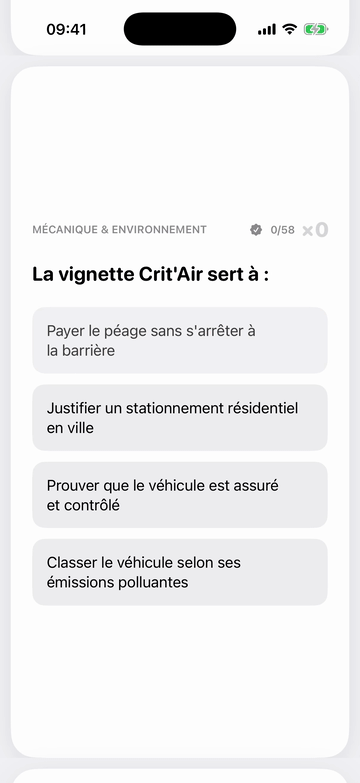

# Valido

Un feed vertical infini qui révise. L'idée est de prendre la place du scroll passif
d'Instagram ou TikTok : même geste, même absence de friction, mais chaque carte est une
question. Deux matières mélangées, le code de la route et Swift/iOS.

Le critère de réussite n'est pas un score d'apprentissage. C'est un réflexe : ouvrir
Valido dans le bus au lieu d'Instagram.

Projet perso, iOS 26.2, SwiftUI, Swift 6.

<p align="center">
  
  
  
  
</p>

---

## Ce qui tourne

Une seule boucle : un `ScrollView` paginé, une carte plein écran, alimentée à l'approche
du bas. Pas de menu, pas d'écran d'accueil, pas d'écran de fin de session — un « bravo,
terminé ! » est une porte de sortie.

**464 questions** embarquées dans le bundle : 271 sur le code de la route, 193 sur
Swift/iOS. Aucun réseau, aucun compte, aucun secret dans l'app.

**Soixante-seize** de ces questions ont leur énoncé **dans une image** — carrefour, panneau,
marquage, vue conducteur. Sans l'image, « qui passe en premier ? » n'a pas de sens : elle
n'illustre pas, elle énonce.

## Structure

```
Valido/
  Model/       types tous `nonisolated` — QuestionBank, CardScheduler,
               ComboEngine, ProgressStore, SchedulerConfig, Illustration…
  ViewModel/   FeedViewModel, @MainActor
  View/        FeedView, QuestionCardView, ComboBadge, ContentErrorView, NotionBadge,
               SourceFilterView
  Resources/   questions.json
  Assets.xcassets/Scenes/   77 imagesets : 52 schémas dessinés, 25 photos
ValidoTests/   84 tests (Swift Testing)
Tools/         audit du contenu, guide de rédaction, registres, rendu des schémas
docs/          les specs de design, les captures du README
```

La cible compile avec `SWIFT_DEFAULT_ACTOR_ISOLATION = MainActor`, ce qui isolerait aussi
les types du modèle — or ce sont des types valeur `Sendable` faits pour être utilisables
partout. D'où les `nonisolated` (SE-0466), qui énoncent la couche : **le modèle est sans
isolation, le view model est `@MainActor`, les vues suivent.**

## Lancer et tester

Xcode avec le SDK iOS 26.2 :

```bash
xcodebuild test -project Valido.xcodeproj -scheme Valido \
  -destination 'platform=iOS Simulator,name=iPhone 17 Pro,OS=26.2'
```

Juger la ligne `✔ Test run with N tests` : Swift Testing rapporte à part, et un
`** TEST SUCCEEDED **` sans elle ne prouve rien.

`CardScheduler` reste la pièce la plus testée, et elle est écrite pour ça — répartition
70/30 sur 1000 tirages à graine fixe, fenêtre anti-répétition, question jamais vue qui
passe devant, question maîtrisée qui reste tirable, banque plus petite que la fenêtre.

## Comment ce projet est construit

Le code est écrit par [Claude Code](https://claude.com/claude-code). Mon travail est en
amont et en aval : j'écris les specs ([`docs/superpowers/specs/`](docs/superpowers/specs/)),
je tranche l'architecture, je relis et je valide chaque étape. Le déroulé est toujours le
même : spec, plan découpé en tâches testables, exécution, revue de la branche entière. Les
décisions ne restent pas dans les specs : chacune vit en commentaire sur le type qu'elle
contraint, et [`CLAUDE.md`](CLAUDE.md) porte ce qu'il faut savoir pour travailler dans le
dépôt.

## Le contenu

`Valido/Resources/questions.json` **est** la source : pas de génération, on édite le
fichier à la main. `python3 Tools/audit.py` le contrôle avant les tests — forme des
distracteurs, fraîcheur juridique, couverture du référentiel, provenance des images — et
[`Tools/questions.md`](Tools/questions.md) est le guide de rédaction. Le code de la route se
périme : chaque question `code` a sa source et sa date de relevé dans `Tools/sources.md`.

**52 schémas** sont dessinés en CoreGraphics par `./Tools/render-scenes.sh` : la scène et la
bonne réponse sortent de la même donnée, donc « qui passe en premier » se vérifie au lieu de
s'espérer. **25 photos** de Wikimedia Commons couvrent les panneaux, qu'on ne redessine pas
à la main ; leur provenance est dans [`Tools/images.md`](Tools/images.md). Tout est dans le
catalogue d'assets, sans réseau, et aucune information ne repose sur la couleur seule.

## Limite connue

464 questions ne font toujours pas un feed infini : à 30 questions par session, la banque
est consommée en une quinzaine. Plusieurs passes de contenu l'ont fait grossir sans changer
cet ordre de grandeur — écrire à la main ne rattrape pas un feed. La v1 répond à
une seule question — la boucle tient-elle sur moi ? Si elle tient, le chantier suivant
n'est pas une fonctionnalité, c'est la génération de questions depuis les pages de cours,
qui alimentera le même `questions.json`.

Reportés, assumés : carte boss, duel, notifications, écran de statistiques, onboarding.

## Licence

Le code est sous licence [MIT](LICENSE). Les 25 photographies de
`Valido/Assets.xcassets/Scenes/` viennent de Wikimedia Commons et gardent leur licence
d'origine (CC BY-SA ou CC BY) ; auteur, source et licence de chacune sont dans
[`Tools/images.md`](Tools/images.md).
